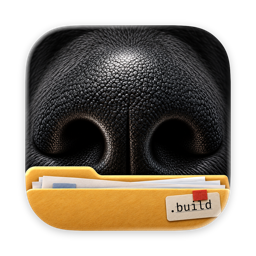
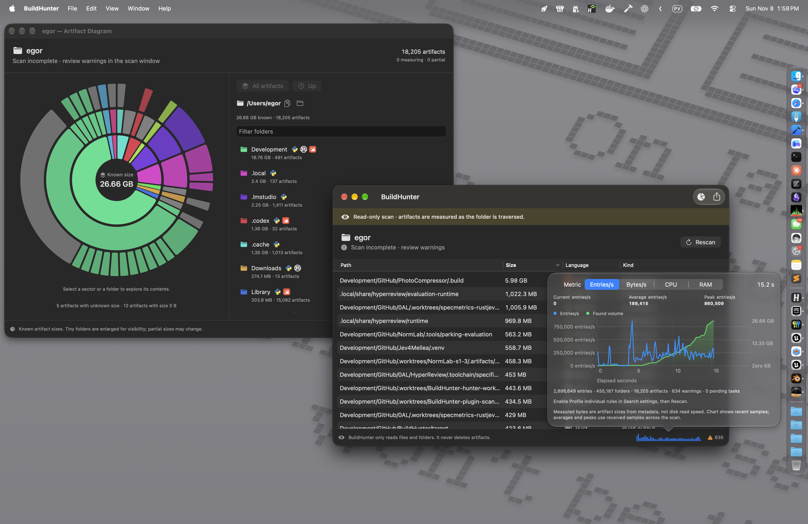

<p align="center">
  
</p>

<h1 align="center">BuildHunter</h1>

Build folders and development caches can quietly consume gigabytes across your projects. BuildHunter makes it amazingly easy to find and measure them, so you can see where your disk space went without hunting through directories by hand.

**Blazing-fast scans: 131,072 files in 145 ms.** That's the median of seven warm runs on a synthetic fixture with the Release CLI on an Apple Silicon Mac; results vary with the filesystem and workload. [See the benchmark](docs/diagnostics/resource-profile-20261012.md) (an earlier revision).

Choose a folder in the macOS app to scan for Swift, Rust, and Python build artifacts and caches. An easy-to-read table shows what was found and how much space it takes, while an interactive, colourful diagram makes it easy to explore where it all adds up. Watch live scan, CPU, and memory metrics, then open a finding in Finder and decide what to do with it. Scans are read-only: BuildHunter never deletes your files.

[Download the 0.1.1 preview](https://github.com/SoundBlaster/BuildHunter/releases/tag/v0.1.1), open the DMG, and drag BuildHunter to Applications. It requires macOS 26 or later on Apple Silicon, and is Developer ID signed and notarized by Apple.



Prefer the terminal, or want to give your coding agent a way to inspect disk usage? The app includes a CLI that produces a JSON report. Run the following after installation, or use `--help` to explore its options:

```sh
/Applications/BuildHunter.app/Contents/MacOS/build-hunter ~/Development --json
```

[Technical reference](docs/reference.md) · [Scan rules](docs/search-settings.md) · [User templates](docs/user-templates.md) · [License](LICENSE)
