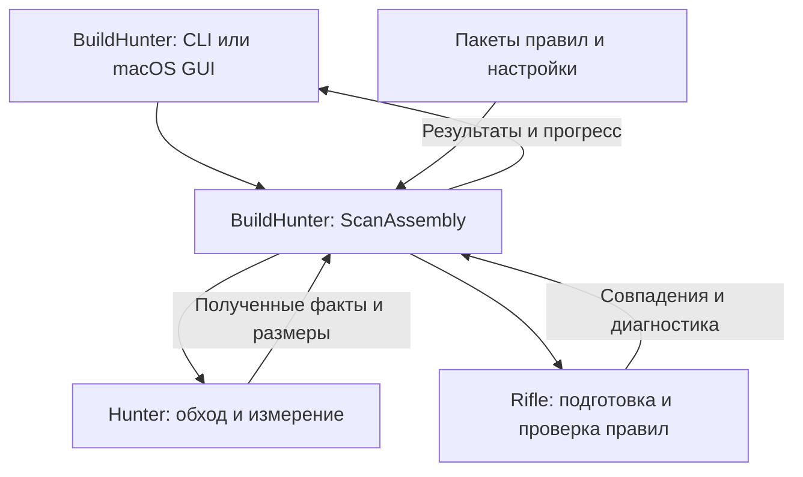

# Hunter, Rifle, BuildHunter и Arsenal: устройство поиска и плагинов

Дата: 2026-10-13. Это проект архитектуры для обсуждения. Названия и продуктовое
направление утверждены; точные интерфейсы ещё проектируются. Основное приложение и scanner пока находятся в BuildHunter. Rifle уже имеет
чистый Rust evaluator и generic catalog/JCS identity. Опциональный адаптер
BuildHunter проверяет plugin policy; независимый `buildhunter-plugin-scanner`
уже соединяет её с обходом через all-candidate observer и scoped Unix markers
([границы пилота](plugin-scanner-integration.md)). Default CLI/GUI/FFI ещё используют
прежние правила; descriptor-bound traversal/measurement остаются следующим этапом.
Hunter частично выделен: Unix metadata primitive находится в `hunter-fs`; portable listing и расчёт байтов
перенесены в std-only `hunter-fs-core`. Generic очередь и scoped запуск workers тоже перенесены. Политика рекурсии,
backend callbacks workers и агрегация ещё в BuildHunter. Typed directory tasks/results
и позиционный measurement plan теперь тоже находятся в Hunter. Коммерческий каталог и pipeline выпуска не реализованы. Разбор существующего кода опирается на commit
`48badf9e097783505151dd47fbafe290f0af25e2`.

## 1. Зачем разделять приложение

BuildHunter ищет локальные артефакты разработки: результаты сборки, кэши и
окружения. Пользователь выбирает папку, получает найденные пути и размеры,
смотрит диаграмму, копирует путь или открывает папку в Finder. Добавление поддержки
нового инструмента должно со временем сводиться к добавлению проверяемого пакета
правил, без изменения обхода файловой системы и интерфейса приложения.

Планируются две комплектации одного приложения:

| Комплектация | Что получает пользователь | Откуда берутся правила |
|---|---|---|
| Открытая, для самостоятельной сборки | CLI и macOS GUI, базовые проверки, возможность добавить свои правила | Публичные пакеты Swift, Rust и Python в BuildHunter; пользовательские пакеты |
| Платная, для Mac App Store | Тот же macOS GUI и движок, готовый расширенный набор проверок, установка и обновления через магазин Apple | Базовый набор плюс коммерческие пакеты из Arsenal, включённые в приложение при сборке |

Далее **«сборка для Mac App Store»** означает вторую комплектацию. В прежних
материалах для неё использовались сокращения `Store edition`, `Store distribution`
и `Store composition`. Это не ещё один движок, хранилище данных или сервер.

Коммерческий набор хранится в приватном репозитории, чтобы его разработка и
исходные определения не публиковались вместе с открытым приложением. Покупателю
передаются готовые правила внутри приложения; приватный репозиторий не гарантирует
секретность поставленных данных. Уже открытые проверки остаются открытыми.
Цена и точный состав платного набора ещё не выбраны.

Универсальный поиск, индекс и LLM относятся к отдельному будущему приложению
под другим именем. Здесь предусматриваются переиспользуемые библиотеки, но эти
возможности не добавляются в BuildHunter.

## 2. Четыре части и их ответственность

Названия ниже обозначают будущие репозитории. Репозиторий может содержать несколько
библиотек, тесты и инструменты подготовки данных: это не обязательно один
исполняемый модуль.

| Репозиторий | Состав и роль | Пример ответственности |
|---|---|---|
| **Hunter**, публичный | Библиотека на Rust для обхода файловой системы, получения метаданных, измерения размеров и управления сканированием | Перечислить папки, проверить наличие запрошенного маркера, измерить размер, отреагировать на отмену |
| **Rifle**, публичный | Библиотека на Rust для проверки и исполнения декларативных правил; Swift SDK для авторов правил | Проверить корректность условия и вычислить его на переданных данных |
| **BuildHunter**, публичный | Приложение и CLI, базовые плагины, правила предметной области и адаптер между Hunter и Rifle | Знать, что `rust.target` — результат сборки Rust; применить исключения пользователя; показать результат |
| **Arsenal**, приватный | Расширенный каталог плагинов, тестовые примеры и пользовательские пояснения | Описать признаки артефактов ещё одной экосистемы и проверить отсутствие ложных совпадений |

**Hunter** знает, как читать файловую систему, но не знает, что такое Rust,
Swift или кэш сборки. Он принимает задания на получение данных и измерение.
Проверка доступа, обработка исчезающих файлов, пропуск выгруженных облачных
объектов и отмена относятся к механике обхода.

**Rifle** получает уже подготовленные данные и возвращает результат проверки.
Он не открывает файлы, не обходит папки и не запускает команды. Это позволяет
использовать один механизм правил с разными источниками данных в будущем.
Правило не может самостоятельно расширить доступ приложения к диску.

**BuildHunter** задаёт смысл данных и результатов. Например, наличие
`Cargo.toml` — технический факт, а решение считать соседнюю папку `target`
артефактом Rust — знание BuildHunter. Здесь же остаются настройки поиска,
категории результатов, учёт вложенных артефактов, таблица, диаграмма и действия
Finder/Copy Path.

**Arsenal** поставляет дополнительные описания правил, а не собственный
исполнитель. Его пакеты проходят тот же механизм проверки и исполнения, что
публичные и пользовательские пакеты.

Rifle пишется с одной `f`. Старые рабочие названия `Riffle` и
`BuildHunterCatalog` больше не используются.

## 3. Что здесь называется плагином

Плагин — пакет данных для одной экосистемы. В нём описано, какие объекты искать,
как объяснять результат пользователю и на каких примерах проверять правила.
Это ограниченный декларативный язык: автор составляет условия из поддерживаемых
операций, а не передаёт приложению произвольную программу.

Чтобы читать остальные документы, нужны следующие различия:

| Термин | Значение в этой архитектуре |
|---|---|
| **Плагин / пакет правил** | Версионированный набор проверок одной экосистемы, например Rust |
| **Target / тип находки** | Именованная проверка внутри пакета, например `rust.target`. Это не выбранная пользователем папка сканирования |
| **Filter ID** | Стабильный идентификатор типа находки, который используется в настройках исключений. Его смысл должен сохраняться при обновлениях |
| **Каталог** | Совокупность подключённых пакетов; может состоять из базового, коммерческого и пользовательского наборов |
| **Fact / факт** | Переданное правилу значение: имя объекта, его тип, наличие маркера и т. п. |
| **Marker / маркер** | Признак окружения, например наличие `Cargo.toml` в родительской папке |
| **Schema** | Формальное описание допустимого формата пакета, полей, типов и версий |
| **IR, intermediate representation** | Переносимое представление правил как данных. Предложен версионированный JSON; точная schema ещё не утверждена |
| **Execution plan / план исполнения** | Подготовленные индексы и условия для повторной проверки многих объектов. Его компиляция не создаёт машинный код |
| **Fixture** | Маленькое тестовое дерево файлов с ожидаемыми находками и примерами, которые не должны совпасть |
| **Digest каталога** | Контрольная сумма нормализованных данных каталога, позволяющая определить, какие именно правила использовал скан |

Пакет содержит ID, версию, описание, совместимость, типы находок, условия,
запросы необходимых фактов и fixtures. Категории вроде «кэш» или «результат сборки»
определяет BuildHunter: пакеты используют общий словарь приложения.

Например, правило **в концептуальном виде**, а не в утверждённом синтаксисе:

> Для типа находки `rust.target`: имя папки — `target`, в родительской папке
> присутствует `Cargo.toml`; результат относится к Rust и категории Build output.

Swift SDK позволяет автору записать такое описание типизированным кодом и
экспортировать данные пакета при его подготовке. Пользователь также сможет
подготовить переносимый манифест напрямую. Установленное приложение исполняет
данные через Rifle на Rust; Swift compiler и Xcode для сканирования не нужны.
Произвольные Swift closures, загружаемые native-библиотеки, JIT и команды shell
в этот формат не входят.

Первая версия передаёт плагинам только имена, типы объектов и own/parent markers.
Сведения об артефакте-предке не входят в факты плагина v1: учёт вложенности и
общего объёма остаётся политикой BuildHunter. Чтение содержимого исходников потребует отдельного расширения движка,
лимитов работы и проверки отмены. Автор плагина не сможет включить его незаметно.

Конкретный проект формата, условий, ошибок и примеров описан в
[контракте плагина v1](plugin-contract-v1.md). Его schema уже проверяется,
но evaluator и интеграция ещё не реализованы.

## 4. Как выполняется один поиск

BuildHunter содержит адаптер, который соединяет получение данных и проверку
правил. В картах он назван **ScanAssembly**: это предлагаемая внутренняя часть
BuildHunter, не отдельный репозиторий и не существующий публичный API.

Стрелки показывают обмен данными через адаптер. Hunter и Rifle не импортируют
друг друга; их совместное использование организует BuildHunter.

Для папки `/Projects/Demo/target` предполагается такой ход работы:

1. **Подготовка.** BuildHunter фиксирует каталог и настройки для всего скана.
   Rifle проверяет версии, идентификаторы и допустимую сложность правил,
   подготавливает план. BuildHunter сопоставляет запрошенные факты с операциями
   Hunter. Неизвестный факт должен дать диагностику, а не скрытое чтение диска.
2. **Обход.** Hunter обнаруживает папку. Адаптер использует дешёвые признаки,
   например имя, чтобы выбрать нужные проверки. Для правила `rust.target`
   потребуется также факт о `Cargo.toml` в родителе.
3. **Получение фактов.** Hunter выполняет необходимые разрешённые проверки
   файловой системы. BuildHunter передаёт значения в Rifle в согласованном
   представлении. Rifle возвращает совпавшие ID и диагностику.
4. **Решение приложения.** BuildHunter применяет исключения пользователя и
   правила вложенности. Совпадение правила само по себе ещё не определяет,
   надо ли показывать находку, измерять её или продолжать обход глубже.
5. **Измерение и вывод.** Hunter измеряет выбранные объекты и передаёт события.
   BuildHunter обновляет общий результат; CLI и GUI представляют его пользователю.
   Обновление настроек или каталога применяется к следующему скану.

Это схема ответственности, не обещание отдельного вызова на каждый шаг или
каждый файл. Индексы кандидатов и предварительное получение маркеров должны
строиться из одного набора правил, иначе новый плагин можно случайно пропустить.
Точное представление запросов фактов, пакетная обработка и лимиты ещё требуют
API-проекта и измерений.

SpecificationCore сохраняется для политик приложения: настройки, допустимость
действий, учёт вложенных результатов. При этом в цикле обхода не должно появиться
обязательного перехода Rust → Swift на каждый файл ради исполнения плагина.
**FFI** — граница вызовов между Rust и Swift; **ABI** — двоичный контракт этой
границы, включая типы, представление данных и время их жизни. Их текущую реализацию
нужно сохранить до проверенной замены новым контрактом.

За совместимость версий Hunter/Rifle, представление путей, единицы размеров,
обработку ошибок и время жизни переданных данных отвечает ScanAssembly.
Это и есть «обязанности сборки компонентов» в формальных спецификациях.

## 5. Как собираются открытая и платная версии

Открытая сборка получает Hunter, Rifle, код BuildHunter и базовые пакеты из
публичных источников. Её сборка и тесты работают без доступа к Arsenal.
Пользовательские пакеты должны подключаться в самостоятельно собранном приложении;
точные расположение файлов и интерфейс импорта пока не выбраны.

Сборка для Mac App Store получает те же версии публичного кода и добавляет
выбранную версию Arsenal в **app bundle**, то есть внутрь пакета `.app`.
Её закрытый pipeline сборки и публикации должен фиксировать версии кода,
формата правил и каталога. Отсутствие обязательного каталога останавливает
сборку, чтобы случайно не выпустить платную версию с одним базовым набором.

Для этого предложен отдельный приватный **репозиторий сборки и публикации**.
Ему принадлежат конфигурация комплектации, интеграционные проверки и выпуск,
а не отдельная копия GUI или scanner. Утверждённое имя —
[BuildHunterMAS](https://github.com/SoundBlaster/BuildHunterMAS), private repository.
Это организационная граница выпуска, а не ещё один библиотечный модуль.
Репозиторий создан; точный pipeline ещё предстоит реализовать.

Коммерческие пакеты в первой поставке обновляются вместе с приложением через
Mac App Store. Собственный сервис загрузки каталогов не требуется этим планом.
Импорт пользовательских пакетов в магазинной версии — отдельное открытое решение,
включая интерфейс и проверку правил Apple перед выпуском. Архитектура сама по себе
не подтверждает готовность к App Review.

## 6. Что уже существует и что предстоит выделить

| Существующий код | Будущий владелец | Необходимое изменение |
|---|---|---|
| `src/lib.rs`: обход, workers, размеры, облачные файлы | Hunter | Отделить механику от имён и категорий артефактов |
| `is_policy_candidate`, `may_classify_directory`, `MARKER_*` | План Rifle и словарь BuildHunter | Совместно заменить отбор кандидатов и получение маркеров на данные каталога |
| Классификация Rust CLI и Swift GUI | Базовые пакеты BuildHunter и Rifle | Сравнить старые и новые результаты, сохранить согласованные различия клиентов |
| Конечная таблица решений и числовые коды C | Адаптер BuildHunter | Сохранить ADR 0002 до проверенного нового ABI |
| Swift bridge: события, доступ, отмена и поколение скана | Адаптер BuildHunter | Сохранить управление ресурсами и защиту от событий уже завершённого скана |
| Таблица, диаграмма, Finder, Settings, export | Приложение BuildHunter | Сохранить на уровне приложения |
| Arsenal и pipeline платной сборки | Новые приватные части | Репозитории созданы; каталог/pipeline ещё требуют реализации и интеграционных тестов |

Текущий каталог фильтров уже работает, но пока не является загрузчиком плагинов.
Выделение Hunter и Rifle потребует изменения границ кода, а не переименования
существующего crate.

Разбор исходников выявил шесть вопросов, обозначенных C1–C6 в
[матрице утверждений и доказательств](../specs/claim-matrix.md):

- **C1 — полнота отбора.** Сейчас Rust заранее ограничивает имена кандидатов и
  маркеров. Одной замены callback недостаточно для произвольного нового правила.
- **C2 — различия CLI и GUI.** GUI узнаёт environment по `pyvenv.cfg` независимо
  от имени и включает его по умолчанию. CLI по умолчанию исключает environments,
  а при включении распознаёт `.venv`/`venv`. Различаются также категории `.tox`,
  `.nox`, bytecode и metadata. Сохранение или унификация — отдельное решение.
- **C3 — символические ссылки.** Обход и измерение пропускают их цели, однако
  `fs::metadata` при проверке маркера разрешает ссылку. Нужно определить единую
  политику проверки маркеров до переноса этой механики в Hunter.
- **C4 — точность путей.** Rust сохраняет исходные байты имени, GUI может заменить
  непредставимые в UTF-8 символы и построить URL из отображаемого текста. Нужен
  точный идентификатор пути либо явное отключение действий для таких имён.
- **C5 — память.** Ограничение очереди Swift в 4096 событий не ограничивает все
  задачи, Rust-хранилища и строки отчёта. Нужны отдельные бюджеты и замеры.
  Результаты исправления #61 подтверждают конкретный прошлый случай.
- **C6 — эффекты.** Сканирование, Finder handoff и Copy Path не изменяют дерево
  файлов. Экспорт и CLI `--profile` записывают выбранный output, в том числе внутри
  сканируемой папки; настройки и clipboard тоже изменяются. `.opened` подтверждает
  вызов API Finder, а не фактическое открытие его окна. Широкую формулировку PRD
  о read-only и исключение для экспорта нужно согласовать как точный контракт.

## 7. Порядок реализации и критерии готовности

1. **Согласовать границы и поведение.** Закрыть вопросы C1–C6, выбрать точные
   факты первой версии и правила разрешения конфликтов. Результат — согласованный
   контракт, который можно проверить на примерах.
2. **Проверить минимальную модель плагина.** Сделать schema, Swift-описание и Rust
   executor для базового и синтетического дополнительного пакета. Синтетический
   пакет проверяет расширяемость без доступа к коммерческому репозиторию.
3. **Подключить текущий поиск.** Согласованно заменить отбор кандидатов, получение
   маркеров и классификацию. Сравнить результаты со старой реализацией на фиксированных
   деревьях: это golden comparison, где различия должны быть объяснены и приняты.
4. **Проверить интеграцию и стоимость.** Подключить CLI/GUI, проверить отмену,
   исчезновение файлов, облачные пропуски, вложенные размеры и FFI. В Release
   сравнить время до первой находки, общее время, CPU и RAM, включая каталог из
   200 типов находок. Подписанную sandbox-сборку проверить отдельно на macOS.
5. **Выделить библиотеки и поставки.** После подтверждения поведения и производительности
   перенести и версионировать Hunter/Rifle, подключить Arsenal и pipeline платной
   сборки. Добавить пользовательский импорт и руководство автора плагинов.

Каждый этап разбивается на небольшие PR с работающим `main`. Конкретные численные
пороги производительности ещё нужно зафиксировать до приёмки runtime; структурная
проверка документации не заменяет эти замеры. Подробный список работ находится в
[плане доставки](plugin-delivery-plan.md).

## 8. Где искать формальные детали

Этот документ объясняет устройство системы. Остальные артефакты нужны для
проверки полноты и сопровождения:

- [ADR 0003](adr/0003-declarative-plugins-and-product-boundaries.md) — причины
  продуктового решения и ограничения поставки.
- [Карты Hypercode](../specs/hypercode/README.md) — состав компонентов сейчас и
  после выделения. Вложенность на карте означает состав, а не порядок вызовов.
- [SpecPM package](../specpm.yaml) — набор **BoundarySpecs**, то есть контрактов
  границ компонентов: входы, выходы, обязанности и ссылки на источники.
- [Claim matrix](../specs/claim-matrix.md) — сопоставление утверждений с кодом,
  вопросами миграции и доказательствами.
- [Progress](../specs/specification-progress.md) — покрытие, статус review и
  реально выполненные проверки.

Контракты остаются draft до согласования. Проверки Hypercode и SpecPM подтверждают
структуру документов; они не доказывают существование новых библиотек или их
поведение. При изменении кода карты и контракты обновляются по корневому
[AGENTS.md](../AGENTS.md), сохраняя прошлые результаты проверки как исторические.

## История выделения

Записи ниже описывают состояние каждого этапа. Текущее объединение приведено в конце;
ранние упоминания pending не отменяют последующие реализации.

### Recursive child planning — 2026-10-15

ChildTraversal/DirectoryRequest now route host-admitted children through the
pinned std-only Hunter core. Product marker/classification/ancestry, cloud/stop
and profiling effects, coordinator state and terminal status remain local.
The opt-in plugin scanner and default CLI/GUI share this mechanical traversal
without switching classification policies or ABI. The remaining generic
coordinator/result bookkeeping is the next boundary; whole-scan memory budgets
remain open. See docs/hunter-child-traversal.md and the fresh source/runtime/map
receipts in specs/validation/hunter-children-20261015. Historical receipts are
retained and do not validate this revision; contracts remain draft.

## Task/result ledger — 2026-10-15

HunterTaskLedger now owns non-reused IDs, opaque listing/deferred state and
expected-response counting. BuildHunter supplies DirNode/PendingMeasure, retires
each received message before stop/dispatch, preserves ignored speculative results
and mirrors counts into existing profiling. Queue rejection/setup failure, guard
lifetime, scope join, subtree completion, C1–C4 product decisions and terminal
status remain host-owned. C5 is open: arena/map capacity and unbounded channels/
reports remain. New draft capability and current scan bindings are covered by
specs/validation/hunter-ledger-20261015 and specs/evidence/hunter-ledger-20261015;
prior receipts remain historical. See docs/hunter-task-ledger.md for protocol and
ownership duties; no full target lifecycle/resource acceptance is claimed.

## Subtree numeric progress — 2026-10-15

HunterSubtreeProgress now owns saturating byte totals, explicit leaf totals,
sticky partial flags, pending-directory/root readiness and one-shot completions.
BuildHunter retains the progress vector/ID mapping, C1–C4 membership/policy/units,
error/status classification and dependent event order. C5 remains open: no new
heap buffers are introduced by the primitive, but retained reports/arena/channel
budgets are unchanged. Draft current scan/target claims and maps are refreshed;
source/runtime/performance receipts are in specs/validation/hunter-subtrees-20261015,
upstream draft/frozen maps in specs/evidence/hunter-subtrees-20261015. Previous
receipts remain historical. See docs/hunter-subtree-progress.md for assembly duties.

Serial result execution is now delegated to Hunter; BuildHunter retains root/backend
admission, product messages/finalization/status and outer scoped worker lifetime.
See [execution boundary](hunter-scan-execution.md) for responsibilities and limits.
This does not complete the generic filesystem engine or plugin/client migration.

Native metadata/listing and one-call root observations now use Hunter; access/cloud
admission, guarded probes, marker/bulk policy and complete scan assembly remain local.
See [native backend boundary](hunter-root-backend.md) for responsibilities and limits.

The shared directory worker protocol now lives in Hunter, with marker/prefetch,
guarded backend/bulk policy and timers in BuildHunter WorkerAdapter. See
[directory worker boundary](hunter-directory-worker.md) for lifecycle and rejection limits.

Owned directory listing acquisition now lives in Hunter. BuildHunter keeps its
marker context observer and intentional link-following effects in the same entry
order. See [directory acquisition boundary](hunter-directory-listing.md).

Typed preparation/measurement now uses Hunter's backend seam; BuildHunter native/
bulk effects are separate from WorkerAdapter. See [measurement boundary](hunter-measurement-backend.md).

Scoped worker startup/shutdown/join now lives in Hunter; product admission/QoS,
status and terminal publication are isolated in BuildHunter scan_session.rs.
See [scoped session boundary](hunter-scoped-session.md).

Root admission now delegates sequencing to Hunter `cc1d8054ea0882e8f954e8bb6b0e6de03cff1495`; the host still owns
cloud policy/guards, scheduling/status and the skip-versus-error control flow.
See [root admission](../docs/hunter-root-admission.md) and the new
`hunter-admission-20261018` evidence; full engine assembly remains pending.

Guard/backend lifetime and native Darwin policy RAII now live in Hunter `3a3db1e270ff54ba757027df3a55b9d378ee0525`.
Host scope placement, cloud paths/error decoration and product status stay local;
see [guarded backend lifetime](hunter-backend-lifetime.md) and `hunter-lifetime-20261018` evidence.
This supersedes earlier pending guard-lifetime ownership notes for the integrated
Rust coordinator/workers; full engine/backend algorithm assembly remains pending.

Owned root/task-response coordination now lives in Hunter 10268f69c41890bb23ab4cdc33d25f3aac8e46d1.
BuildHunter ArtifactHandler implements TraversalHandler and retains domain interpretation,
without queue/ledger fields. See [coordinator boundary](hunter-traversal-coordinator.md).
Full generic engine/child-routing assembly remains pending.

Child routing and selected metadata reconciliation now live in Hunter 2031df50f8324eaaf91856c5dc382d35694b2fd4.
Product access/selection/aggregation remain in ArtifactChildren and ArtifactMeasurements.
See [entry processing](hunter-entry-processing.md); complete engine facade remains pending.

### Текущее объединение ScanEngine — 2026-10-19

Общий serial ScanEngine уже объединяет coordinator, routing и выбранные измерения.
BuildHunter реализует один ScanHandler; ArtifactBranch хранит только продуктовый
контекст ветки. Прежние отдельные ArtifactChildren/ArtifactMeasurements и PendingMeasure
больше не нужны. [Граница двигателя](hunter-scan-engine.md) описывает callbacks,
владение и оставшиеся обязанности приложения. Factory backend/workers, descriptor
recursion, миграция default plugins и C5 resource budgets ещё не завершены.

### Engine startup — 2026-10-20

Hunter ScanSession::run_engine теперь владеет каналом ответов и общим вызовом ScanEngine.
Приложение создаёт ArtifactHandler и собирает данные отчёта в callbacks; служебный progress
освобождается до join, а итоговые события остаются после join. Это расширение существующей
guarded scan assembly, не новый модуль или policy framework. См. [startup boundary](hunter-engine-launch.md).
