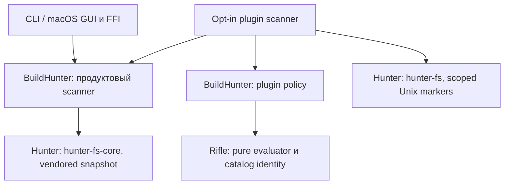

# Сверка модульного рефакторинга — 2026-10-20

Историческая сверка. Текущий статус и backlog после переноса batch backend и
OS primitives: [аудит 2026-10-22](modular-refactor-audit-20261022.md).

Сверены актуальные `main`: BuildHunter
`7ab00f16ae437fe88427c2acbe1b651b30b044f1`, Hunter
`860d995374d677d68b39093101da25c3cacfff9b`, Rifle
`693a284123faaa1ad3192cd88b259ba97a7b5910`. Fetch подтвердил совпадение локальных
ревизий с `origin/main`. BuildHunter использует точный snapshot core Hunter
`40c0f5384c70879f529c6069d835dafff316567a`; merge upstream #21 содержит его.
Это сверка исходников и draft-контрактов, без изменения runtime или принятия
новых требований. Исторические этапы в документации не являются текущим backlog.

**Вывод:** общий цикл сканирования и его запуск уже выделены. Остался конкретный
системный код backend и telemetry; новая фабрика поверх существующих callbacks
сама по себе не завершит эти работы. Миграция default clients на плагины — другая,
ещё не завершённая часть целевой архитектуры.

## Реальные зависимости

Это зависимости кода, а не последовательность событий. В default Cargo graph
нет Rifle или plugin scanner. Scoped markers пилота используют отдельный старый
pin Hunter `5c8f3c9a1a018039b5aea9b731f2fb744f625b5a`; это не тот же snapshot,
что vendored core. Версии нужно будет согласовать перед выпуском.
SpecificationCore остаётся Swift application policy в BuildHunter, в Hunter
он не импортируется. Hunter и Rifle не зависят друг от друга.

## Что выполнено, а что осталось

«Выделено» ниже означает наличие реализации и интеграции на указанных ревизиях,
а не принятие всего `hunter.design.scan` или доказательство всех сценариев.

| Роль / draft claims | Состояние и владелец сейчас | Источники / предел доказательства |
|---|---|---|
| Traversal / `hunter.design.scan/generic_facts` | **Выделено:** очередь, task/result ledger, recursive child planning, serial coordinator и ScanEngine принадлежат Hunter. BuildHunter передаёт opaque branch/selection и решения | `vendor/hunter-fs-core/src/{work,task,children,ledger,coordinator,processing,engine}.rs`; `src/lib.rs: ArtifactHandler` |
| ScanLifecycle / `hunter.design.scan/lifecycle` | **Выделено в согласованном объёме:** guarded session, helpers/workers, канал, factory, pre-join collect, stop/close/join. Final status и Finished остаются продукту | `vendor/hunter-fs-core/src/{session,lifetime,assembly,launch}.rs`; `src/scan_session.rs`. Collect может выполниться до обнаружения worker panic на join; Drained не означает успех |
| MetadataMeasurement / `hunter.design.scan/io_contract` | **Частично:** portable backend, byte primitives, ordered listing, typed prepared measurement и reconciliation уже в Hunter. Darwin batch acquisition/decoder и batch-to-stat preparation ещё в BuildHunter | `vendor/hunter-fs-core/src/{backend,listing,measurement,processing}.rs`; `src/{bulk_metadata,measurement}.rs` |
| PlatformGuards / `hunter.design.scan/io_contract,lifecycle` | **Частично:** native non-materializing guard и scoped lifetime уже в Hunter. Capture/apply requested thread QoS ещё в BuildHunter | `vendor/hunter-fs-core/src/{materialization,lifetime}.rs`; `src/thread_qos.rs`; host выбирает, на каких потоках установить guard/QoS |
| Telemetry / `hunter.design.scan` scope | **Не полностью выделено:** OS process CPU/RSS reader ещё в BuildHunter; это переиспользуемая системная часть. Counters artifacts/warnings, профиль C ABI и JSON/UI — продуктовые | `src/{process_resources,profile,resources}.rs`. RSS всего процесса не является потреблением одного скана |
| ArtifactPolicy / `buildhunter.design.product/policy_owner,assembly_owner` | **Намеренно в BuildHunter:** имена/marker bits, exclusions, ancestry/membership, категории, byte interpretation, warnings/status, callbacks и UI | `src/lib.rs`, `src/policy_table.rs`, `src/scan_session.rs`; `macos/Sources/BuildHunter/Domain/{ClassifyArtifactRoot,SearchFilters}.swift`. Это не долг выделения Hunter |
| Pure rules / `rifle.design.rules/pure_evaluation,bounded_plan,reproducibility` | **Реализовано как пилот:** typed three-valued evaluation, limits, generic catalog и JCS digest. Candidate index отсутствует; каждый bounded rule вычисляется напрямую | Rifle `src/{lib,validate,catalog,identity}.rs`, `docs/{contract,catalog-identity}.md`. Лимиты IR не равны пределу RSS приложения |
| SwiftAuthoring / `rifle.design.rules/swift_authoring` | **Не реализовано:** Swift DSL/export SDK отсутствует. Runtime Swift compiler/JIT не предполагается | Rifle Cargo/source tree и README; target role сохранена, но не помечается выполненной |
| BasicPlugins + ScanAssembly / `buildhunter.design.product/plugin_adapter,migration_parity` | **Пилот, не default:** независимые plugin-policy и plugin-scanner поддерживают arbitrary candidates/markers и target metadata. CLI/GUI/Settings/FFI используют прежние фиксированные policies | `crates/buildhunter-plugin-{policy,scanner}/Cargo.toml`, [пилот](plugin-scanner-integration.md), `src/main.rs`, `RustScanEventSource.swift`, `ClassifyArtifactRoot.swift` |
| C1/C2: catalog selection и client profiles | **Открытая миграция:** заменить candidate gate, marker acquisition и speculative prefetch согласованно; сохранить либо явно принять различия CLI/GUI | `is_policy_candidate`, `may_classify_directory`, `marker_flag`, `rust_cli_policy`; `buildhunter.current.classification/selection,client_profiles` |
| C3/C4: filesystem identity | **Открыто:** scoped no-follow markers уже есть в пилоте на Unix, но default markers намеренно разрешают ссылки. Общий traversal/measurement остаётся pathname-based; GUI actions используют декодированные пути | `crates/buildhunter-plugin-scanner/src/scope.rs`, Hunter `src/scoped_metadata.rs`, `Probes.marker_is_file`, `RustScanEventSource.swift`. Marker safety не доказывает безопасность всего обхода при подмене каталогов |
| C5: memory budgets / `hunter.design.scan/memory_budget` | **Открытая новая работа:** Swift transport ограничен отдельно; Rust tasks, result channel, ledger/progress, reports/diagnostics и pending profile samples имеют отдельное хранение без общего бюджета | `vendor/hunter-fs-core/src/{work,ledger,launch}.rs`, `src/{lib,profile}.rs`. Переезд в библиотеку не изменяет retention; исправление старых UI projections не закрывает C5 |
| Arsenal / StoreDistribution / `edition,store_delivery` | **Поставка не реализована:** наличие репозиториев и политики стоимости CI не означает готовый коммерческий каталог или pinned app-bundle composition | Продуктовая цель из [плана](plugin-delivery-plan.md); private definitions/fixtures не входят в публичные доказательства. Тяжёлые проверки Arsenal только локально либо на отдельно настроенном trusted self-hosted runner |
| Public/user-plugin delivery | **Не реализовано end-to-end:** места импорта, diagnostics UX, release alignment Hunter/Rifle и authoring guide ещё нужны | [План доставки](plugin-delivery-plan.md), этапы 0–5. Store import и App Review остаются отдельными решениями |

## Следующая граница: Darwin batch metadata backend

Это оставшаяся реальная реализация, а не ещё один launcher:
`src/bulk_metadata.rs` содержит open/getattrlistbulk, aligned buffer, checked
decoder и per-name metadata outcomes. `src/measurement.rs` дополнительно хранит
prepared batch, consume-once lookup, fallback и привязку к ScanControl.

Предлагаемый следующий stack:

1. **Hunter:** вынести acquisition/decoder за generic API. На вход — путь и
   stop/checkpoint callback; на выход — lossless names, apparent/allocated sizes
   и исходные I/O errors. Без ScanControl, artifact/filter IDs или UI vocabulary.
   Сохранить feature opt-in, no-follow последнего компонента, буфер и порядок
   cancellation. Полную descriptor-bound recursion здесь не обещать.
2. **Hunter + BuildHunter:** перенести переиспользуемую prepared batch/fallback
   механику, оставив host adapter для profiling counters, injected probes и
   product error decoration. Если конкретная часть зависит от продуктового
   контракта, оставить её явно в адаптере, а не расширять generic API без нужды.

**Критерии приёмки:** совпадение allocated/apparent bytes для обычных, sparse,
hard-linked и resource-fork fixtures; malformed/truncated/negative records;
per-entry errors; unsupported/missing fallback; cached error без повторного I/O;
отсутствие лишних probes при пустом наборе; прежние stop/guard/panic и
pre-cancelled preparation boundaries. Default portable CLI/GUI и ABI не меняются.
Парные Release budgets проверяют отсутствие регрессии, не требуют заранее
обещанного ускорения. Linux/Windows проверяют portable graph; macOS проверяет
сам batch backend. Тесты для будущего переноса сейчас заново не запускались.

После backend — отдельный небольшой перенос **requested QoS и process resource
snapshot**. Переносить в Hunter системные primitives; product ScanProfileSample,
artifact/warning counters, формат событий и UI оставлять в BuildHunter. Это
отдельный оставшийся target scope, а не требование переписать всю telemetry.
Generic detection dataless/cloud metadata можно уточнить рядом с backend;
решение исключать целые managed-cloud locations и пользовательские сообщения
остаётся в host adapter.

## Когда закончить именно перенос кода

У этапа extraction есть конечный результат:

- общий цикл, workers и lifetime уже находятся в Hunter;
- batch backend и указанные OS primitives перенесены либо имеют явное
  обоснование оставаться host-specific;
- в BuildHunter нет второй копии общей механики; его оставшиеся callbacks
  выражают продуктовые решения, тестовые probes или ABI/telemetry adaptation;
- pins, source identities, maps/specs и release dependency policy согласованы;
  портируемые и macOS Release gates проходят.

Autonomous backend/worker factory **не обязательна сама по себе**: native или
batch backend может выбирать приложение через существующие typed seams. Нужна
лишь конкретная reusable реализация и проверяемая ownership boundary. Это
архитектурная рекомендация аудита, не новое принятое требование.

Затем остаются самостоятельные этапы: (1) descriptor-bound traversal/measurement
с явной race/security semantics; (2) C5 budgets и замеры; (3) default plugin
migration с C2/C3/C4 решениями; (4) Swift SDK, user import и коммерческая поставка.
Они нужны полной целевой системе, но не повод бесконечно дробить уже выделенный
ScanEngine. Для plugin migration сначала закрепить parity fixtures и profile
decisions, затем менять default clients. Индекс, LLM и универсальное приложение
по-прежнему вне этого scope.

## Доказательства и ограничения

Исходные SHA-256, публичные ревизии и свежие structural commands сохранены в
[`specs/validation/modular-audit-20261020`](../specs/validation/modular-audit-20261020/).
Current HC composition по исходникам остаётся верной; изменены пояснения target
roles и устаревшие обзорные формулировки. Подробные constraints не ослаблены,
BoundarySpecs остаются draft. C6 scoped effects также не меняются этим аудитом.

Runtime validation переноса launch хранится отдельно в
[`hunter-engine-launch-20261020`](../specs/validation/hunter-engine-launch-20261020/):
там есть локальные tests и fixture Release budgets. Эти результаты исторические,
относятся к pinned runtime inputs и здесь не выдаются за новый прогон. Сверка
не подтверждает свежую работу на `~/`, live iCloud, UI/AX, общую экономию CPU/RAM,
безопасность всего обхода при replacement или готовность к Mac App Store.
